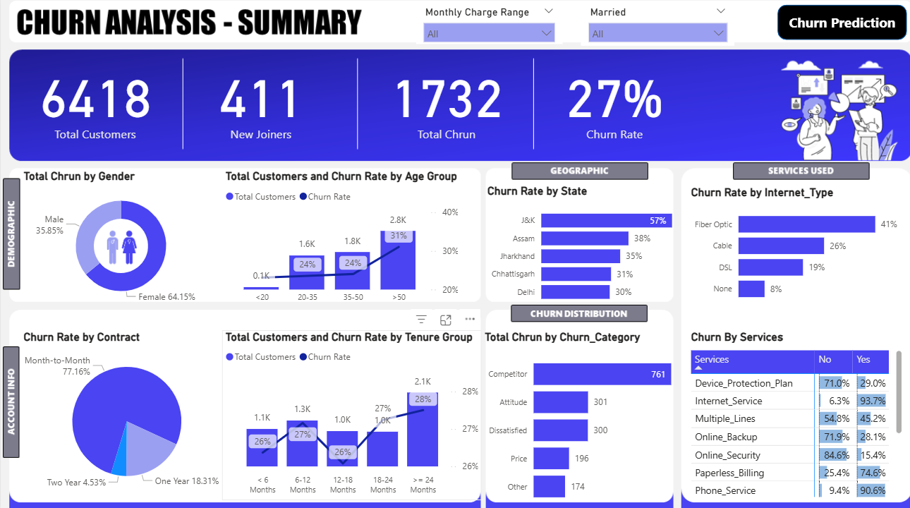
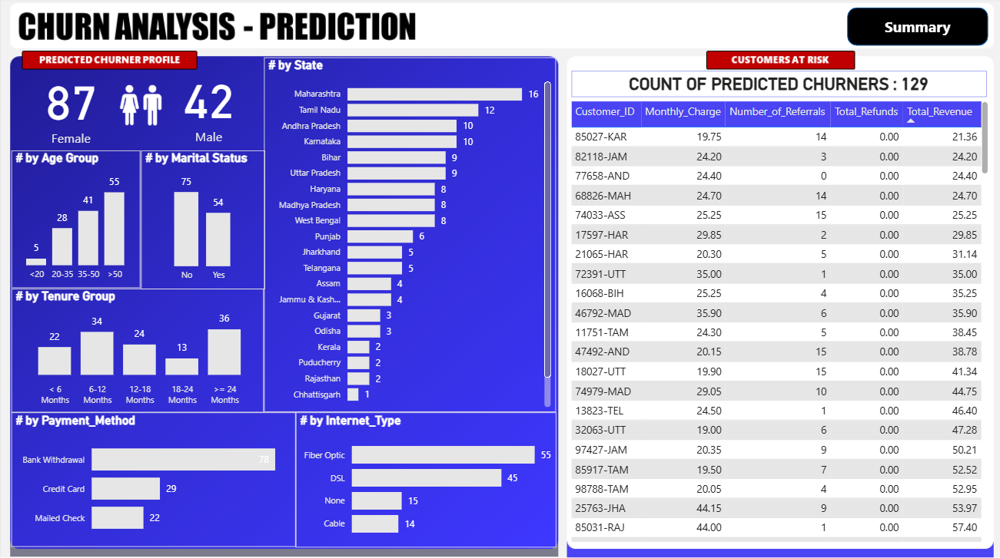

# Customer Churn Analysis

An end-to-end data analytics project analyzing customer churn patterns for a telecom company using MySQL, Python, Power BI, and Machine Learning.

---

## Project Overview

This project analyzes why customers leave a telecom service and predicts which new customers are likely to churn. The pipeline covers data ingestion, SQL-based ETL, machine learning, and interactive Power BI dashboards.

---

## Tools and Technologies

- **Database:** MySQL 8.0
- **Languages:** Python, SQL, DAX
- **Libraries:** pandas, scikit-learn, matplotlib, seaborn, joblib, mysql-connector-python
- **Visualization:** Power BI Desktop
- **ML Model:** Random Forest Classifier

---

## Project Architecture

```
Raw CSV Data
    ↓
Python (mysql-connector) - Data Import
    ↓
MySQL - Staging Table (stg_churn)
    ↓
MySQL - ETL + Null Handling - Production Table (prod_churn)
    ↓
MySQL - Views (vw_ChurnData, vw_JoinData)
    ↓
Power BI - Dashboard (Summary + Churn Reason + Churn Prediction)
    ↑
Python (scikit-learn) - Random Forest Model - Predictions CSV
```

---

## Dataset

- Source: Kaggle - Telecom Customer Churn Dataset
- Records: 6,418 customers
- Features: 32 columns including demographics, services, charges, and churn status

---

## Project Structure

```
customer-churn-analysis/
│
├── data/
│   └── Customer_Churn_Data.csv
│
├── notebooks/
│   ├── churn_data_import.ipynb
│   └── churn_ml_model.ipynb
│
├── sql/
│   └── churn_etl_queries.sql
│
├── powerbi/
│   └── Customer_Churn_Analysis.pbix
│
├── assets/
│   ├── summary_dashboard.png
│   └── prediction_dashboard.png
│
└── README.md
```

---

## SQL ETL Pipeline

**Staging Table:** Raw CSV data loaded into `stg_churn` via Python

**Data Cleaning:** NULL values replaced using `COALESCE`
- Service columns: NULL replaced with `'No'`
- Value Deal: NULL replaced with `'None'`
- Churn Category/Reason: NULL replaced with `'Others'`

**Production Table:** Clean data moved to `prod_churn`

**Views Created:**
- `vw_ChurnData` - Churned and Stayed customers for analysis
- `vw_JoinData` - Newly joined customers for churn prediction

---

## Machine Learning Model

**Algorithm:** Random Forest Classifier

**Preprocessing:**
- Label Encoding for 19 categorical columns
- Target variable encoding: Stayed = 0, Churned = 1
- Train/Test Split: 80% / 20%

**Results:**
- Model predicts which newly joined customers are at risk of churning
- Predictions exported to CSV and loaded into Power BI Prediction page
- Feature importance chart generated to identify top churn drivers

---

## Power BI Dashboard

### Dashboard Preview

**Customer Churn Summary**



**Customer Churn Prediction**



**3 Pages:**

**1. Summary Page**
- KPI Cards: Total Customers, New Joiners, Total Churn, Churn Rate (27%)
- Churn by Gender, Age Group, Tenure Group
- Churn by State (Top 5), Internet Type, Contract
- Services usage matrix
- Churn distribution by category
- Filters: Monthly Charge Range, Married status

**2. Churn Reason Page**
- Detailed breakdown of churn reasons and counts

**3. Churn Prediction Page**
- Predicted churner profile (by gender, age, tenure, contract)
- State-wise predicted churners
- Customers at risk table with Customer IDs

---

## Key Insights

- Overall churn rate is **27%**
- **Month-to-Month** contract customers have the highest churn rate at **77.13%**
- **Fiber Optic** internet users churn the most at **41%**
- **Competitor** is the top churn reason with 761 customers lost
- Customers with tenure **less than 6 months** are at highest churn risk

---

## How to Run

**1. MySQL Setup**
Run `sql/churn_etl_queries.sql` in MySQL Workbench to create the database and staging table. Then run the data-import notebook to load the CSV, followed by the remaining SQL ETL statements to populate the cleaned table and views.

**2. Python - Data Import**
```bash
pip install pandas mysql-connector-python openpyxl
```
Run `notebooks/churn_data_import.ipynb`. Set your MySQL credentials and use the CSV at `data/Customer_Churn_Data.csv`.

**3. Python - ML Model**
```bash
pip install scikit-learn matplotlib seaborn joblib
```
Run `notebooks/churn_ml_model.ipynb`. This notebook currently expects a locally exported `prediction_Data.xlsx` workbook with `vw_churndata` and `vw_joindata` sheets; export those views first and update the workbook path.

**4. Power BI**
Open `powerbi/Customer_Churn_Analysis.pbix` in Power BI Desktop
Update MySQL connection credentials and data source paths if needed.

Dashboard screenshots are available above and in the [`assets/`](assets/) folder.

---

## Author

**Shantanu Shrivastava**  
B.Tech CSE (AI/DS) | AKS University, Satna  
[LinkedIn](https://www.linkedin.com/in/shantanushrivastava/) | [GitHub](https://github.com/shantanushrivastava)
